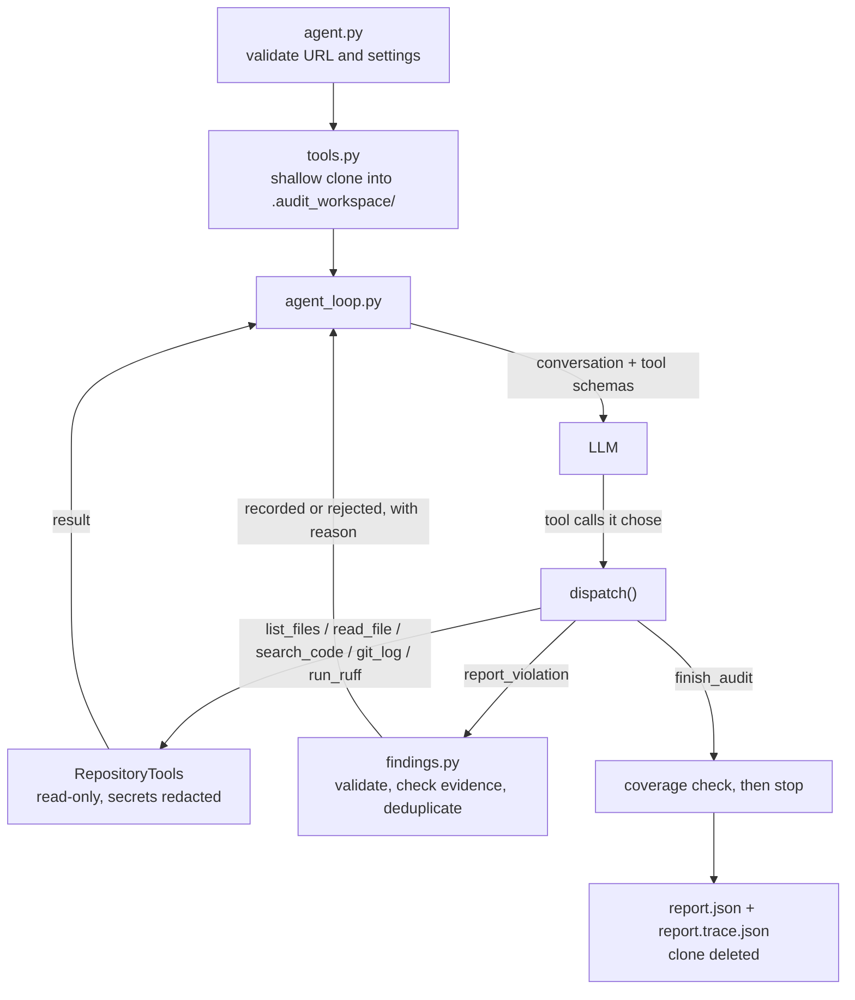

# DevOps Repository Auditing Agent

An LLM-driven agent that inspects a public GitHub repository, investigates DevOps best-practice
violations with its own tools, and writes an evidence-based JSON report with recommendations.

The agent loop, tool dispatch and control flow are written in plain Python. No agent frameworks
(LangChain, LangGraph, n8n, etc.) are used; the only LLM dependency is the `openai` SDK, which
talks to any OpenAI-compatible provider.

## How it works



Each step follows the cycle **Observe → Reason → Select tool → Execute → Interpret → Report**:

1. The LLM receives the conversation so far and the tool definitions (JSON Schema).
2. It decides which tool to call next, based on what earlier results showed.
3. Python validates the arguments, runs the tool and returns the result to the LLM.
4. When the evidence confirms a problem, the LLM calls `report_violation`.
5. On its first `finish_audit`, the LLM is asked to confirm it covered every inspection area. The
   audit ends on the second `finish_audit`, or when the step limit is reached.

### Tools

| Tool | Purpose |
|---|---|
| `list_files(directory)` | Files tracked by git, with sizes |
| `read_file(path, start_line, max_lines)` | Numbered lines of a text file, paged for long files |
| `search_code(pattern, file_glob)` | Regular-expression search over tracked files, returning `file:line: snippet` |
| `git_log(max_commits, path)` | Recent commits with files added, modified or deleted |
| `run_ruff(path)` | Ruff static lint using the target's own configuration (optional extra) |
| `report_violation(...)` | Records one finding (control tool) |
| `finish_audit(summary)` | Ends the audit (control tool) |

### Precision safeguards

- **Evidence grounding.** A finding may name a file only if a tool showed that file, and a line
  only if `read_file`, `search_code` or `run_ruff` showed that line. Unsupported findings are
  rejected and the LLM is told why.
- **Acceptable alternatives.** The prompt requires checking for equivalents (tox, pre-commit,
  lockfiles, `README.rst`, ...) before reporting a missing practice.
- **Deduplication** by rule, file and line; the category is derived from the rule ID prefix.

### Safety

- The target is cloned with `--depth 200`, `core.symlinks=false` and no credential prompts.
  It is never modified, and its code is never executed (Ruff only parses files).
- Tools refuse paths outside the clone (`..`, absolute paths) and skip binary and very large files.
- Secret values are masked (`<REDACTED_VALUE length=N>`) before anything reaches the LLM, the
  logs, the trace or the report. Placeholders such as `changeme` are left visible.
- The clone is deleted when the audit ends, including after errors.

## Requirements

- Python 3.11 or newer
- Git on `PATH`
- An API key for an OpenAI-compatible LLM provider. The defaults use
  [Groq](https://console.groq.com) (free tier, no card needed) with `openai/gpt-oss-120b`.

## Installation

Windows (PowerShell):

```powershell
git clone https://github.com/<your-username>/devops-audit-agent.git
cd devops-audit-agent
python -m venv .venv
.venv\Scripts\Activate.ps1
python -m pip install -r requirements.txt
Copy-Item .env.example .env
```

Linux / macOS:

```bash
git clone https://github.com/<your-username>/devops-audit-agent.git
cd devops-audit-agent
python3 -m venv .venv
source .venv/bin/activate
python -m pip install -r requirements.txt
cp .env.example .env
```

Then open `.env` and set `LLM_API_KEY`. Real environment variables take priority over `.env`.

## Configuration

| Variable | Default | Description |
|---|---|---|
| `LLM_API_KEY` | (required) | Provider API key |
| `LLM_BASE_URL` | `https://api.groq.com/openai/v1` | Any OpenAI-compatible endpoint |
| `LLM_MODEL` | `openai/gpt-oss-120b` | Model ID; it must support tool calling |
| `LLM_REASONING_EFFORT` | (unset) | `low`, `medium` or `high`, for models that support it |
| `LLM_REQUEST_TIMEOUT_SECONDS` | `120` | Timeout per LLM request |
| `LLM_MAX_RETRIES` | `5` | Retries on rate limits (429) and server errors, with backoff |
| `AGENT_MAX_STEPS` | `30` | Maximum LLM steps per audit (`--max-steps` overrides it) |
| `AGENT_CONTEXT_CHAR_BUDGET` | `12000` | Conversation size kept before old tool results are shortened |

Other providers only need different values, for example:

| Provider | `LLM_BASE_URL` | Example `LLM_MODEL` |
|---|---|---|
| OpenAI | `https://api.openai.com/v1` | `gpt-4.1-mini` |
| Google Gemini | `https://generativelanguage.googleapis.com/v1beta/openai/` | a current Flash model |
| Ollama (local) | `http://localhost:11434/v1` | `qwen3:14b` (any value works as the key) |

## Usage

```bash
python agent.py --repo https://github.com/<owner>/<repository> --output report.json
```

| Option | Description |
|---|---|
| `--repo` | Public GitHub repository URL (required) |
| `--output` | Report path (default `report.json`) |
| `--trace` | Trace path (default `<output name>.trace.json`) |
| `--max-steps` | Overrides `AGENT_MAX_STEPS` |
| `--verbose` | Debug logging |

The run is unattended. Progress (`Step N: tool(arguments)`) is logged to stderr.

### Outputs

- **`report.json`**: the report, in the required format. It contains an empty `violations` array
  when nothing is found, and `null` for a `file` or `line` that does not apply.
- **`report.trace.json`**: every tool call with its arguments, status, duration and a result
  preview, plus the model, stop reason, steps used and token count.
- **`report.partial.json`**: written only when the audit fails partway, with the findings
  gathered before the failure. `report.json` is not written in that case.

```json
{
  "repository": "https://github.com/example/demo-project",
  "violations": [
    {
      "rule_id": "SEC-001",
      "category": "security",
      "severity": "critical",
      "file": "config.py",
      "line": 17,
      "description": "Hardcoded API credential",
      "evidence": "Credential assigned directly in source code",
      "recommendation": "Use a secrets manager or environment variable"
    }
  ]
}
```

`sample_report.json` is a real report produced by this agent.

### Exit codes

| Code | Meaning |
|---|---|
| `0` | Audit completed and report written |
| `1` | Clone failed, or the LLM provider failed during the audit |
| `2` | Invalid input: bad URL, missing API key or invalid setting |
| `130` | Interrupted with Ctrl+C |

## Inspection areas and rules

The rule catalogue lives in [`prompts.py`](prompts.py). It contains generic rules only; nothing is
specific to any repository.

| Prefix | Category | Examples |
|---|---|---|
| `HYG` | repository_hygiene | Missing README, unsuitable `.gitignore`, tracked generated files |
| `DEP` | dependency_management | Missing manifest, weak pins, inconsistent specs, missing lockfile |
| `CQ` | code_quality | No linter or formatter, obvious maintainability problems |
| `TST` | testing | No tests, tests not run in CI, disabled tests |
| `CI` | ci | Wrong triggers, ineffective gates, skipped validation, moving action refs, no CI |
| `SEC` | security | Hardcoded credentials, committed secret files, broad permissions, script injection |
| `CFG` | configuration | Machine-specific paths, committed local settings, poor environment separation |
| `COL` | collaboration | Unsafe PR automation, missing review guidance |
| `BLD` | build_release | No build validation, risky release automation |

## Project structure

```
agent.py          CLI entry point: arguments, clone, run, write report and trace, exit codes
agent_loop.py     The agent loop: LLM calls, tool dispatch, context management, limits
tools.py          Read-only inspection tools and safe cloning
llm_client.py     OpenAI-compatible client, response parsing, error mapping
tool_schemas.py   JSON Schema definitions of every tool
prompts.py        System prompt, rule catalogue and steering messages
findings.py       Violation model, validation, evidence ledger, deduplication
redaction.py      Secret masking
config.py         Settings from environment variables and .env
tests/            Unit and agent-behaviour tests (fake LLM, no API key needed)
```

## Tests

```bash
python -m pip install -r requirements-dev.txt
python -m ruff check .
python -m pytest -q
```

The agent-loop tests use a scripted fake LLM, so they need no API key or network access.
They cover tool dispatch, error recovery, step limits, evidence checks, secret redaction and
the CLI contract. Set `RUN_NETWORK_TESTS=1` to also run the real-clone test.

GitHub Actions runs lint, the format check and the tests on Ubuntu and Windows for every push
and pull request.

## Limitations

- Only public GitHub repositories are supported.
- Tests in the target repository are never executed, so failing tests are detected from static
  evidence only.
- Only the latest 200 commits are inspected.
- Results depend on the model. Free-tier rate limits make audits slower (429 responses are retried
  automatically).
- Remote settings (branch protection, repository secrets) cannot be inspected from files and
  are not reported.
